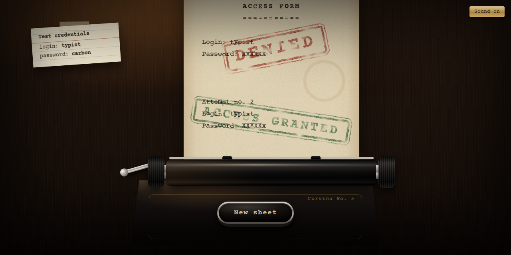

# Typewriter login

[English](README.md) · **Português**

**[Demo ao vivo](https://rianemilio.github.io/typewriter/)**



Um formulário de login datilografado em uma máquina de escrever antiga. A máquina
datilografa o cabeçalho do formulário, você digita login e senha na folha, e o
resultado desce como um carimbo de borracha: **DENIED** avança o papel para uma
nova tentativa, e **ACCESS GRANTED** permite ejetar a folha e começar de novo.

Feito com React 18, TypeScript, Vite e SCSS modules. Todo o visual é feito com
gradientes, sombras e SVG inline em CSS, e todos os sons são sintetizados com a
Web Audio API. A aplicação não usa nenhum arquivo de imagem ou áudio.

## Como rodar

Requer Node 20.19+ (ou 22.12+).

```sh
npm install
npm run dev      # http://localhost:5173
npm run build    # checagem de tipos e build de produção em dist/
npm run preview  # serve o build de produção
```

Cada push na `main` publica no GitHub Pages pelo `.github/workflows/deploy.yml`
(ative uma vez em *Settings → Pages → Source: GitHub Actions*).

Credenciais de teste: `typist` / `carbon` (também estão no cartão sobre a mesa).

## Conectando uma API de autenticação real

Toda a verificação de credenciais fica em [`src/services/auth.ts`](src/services/auth.ts):

```ts
export async function login(username: string, password: string): Promise<boolean>
```

Troque o corpo da função por uma requisição ao seu backend que resolva `true` ou
`false`. Nada mais precisa mudar: a máquina já aguarda essa promise enquanto o
carro está parado no fim do formulário e depois carimba o resultado. Uma promise
rejeitada (erro de rede, 500…) é carimbada como DENIED.

Com credenciais reais no lugar, remova o cartão de credenciais de
`src/components/Desk/Desk.tsx`.

## Organização

```
src/
  App.tsx                     <Desk> com <Typewriter> dentro
  components/
    Desk/                     fundo, luz da luminária, vinheta, cartão de credenciais, botão de som
    Typewriter/
      Typewriter.tsx          monta as partes, liga entrada de teclado e sons
      machine.ts              estado, ações, reducer, geometria da folha
      sequences.ts            datilografia e carimbo automáticos de cada fase
      useMachine.ts           useReducer com um espelho síncrono do estado
    Carriage/                 rolo, botões, barra do papel, alavanca; desliza na horizontal
    Paper/                    a folha, as linhas datilografadas e os carimbos; avança na vertical
    Stamp/                    a marca do carimbo e o filtro SVG de tinta gasta
    ReturnKey/                a tecla mecânica Return / New sheet
  hooks/
    useTypewriterSound.ts     síntese Web Audio e o liga/desliga do som
    useHiddenInput.ts         input invisível que captura as teclas (inclusive teclados de celular)
  services/auth.ts
  styles/                     tokens, mixins de materiais, keyframes, estilos globais
```

O fluxo é uma máquina de estados explícita:

```
intro → typingLogin → typingPassword → validating ─┬→ denied → typingLogin …
                                                   └→ granted → ejecting → intro
```

Cada fase pode disparar uma sequência automática (veja `sequences.ts`). As
sequências rodam em um effect com `AbortController`, então param corretamente ao
desmontar o componente e no StrictMode do React. As teclas são ignoradas enquanto
uma sequência está rodando.

A folha é só dado: linhas de caracteres, cada um com uma variação de tinta
(deslocamento, inclinação e opacidade) sorteada no momento em que é datilografado,
mais uma lista de carimbos. As posições do carro e do papel são derivadas da
coluna e da linha atuais.

## Inspiração

Inspirado [neste vídeo](https://youtu.be/-LMhNfYPLP0).
